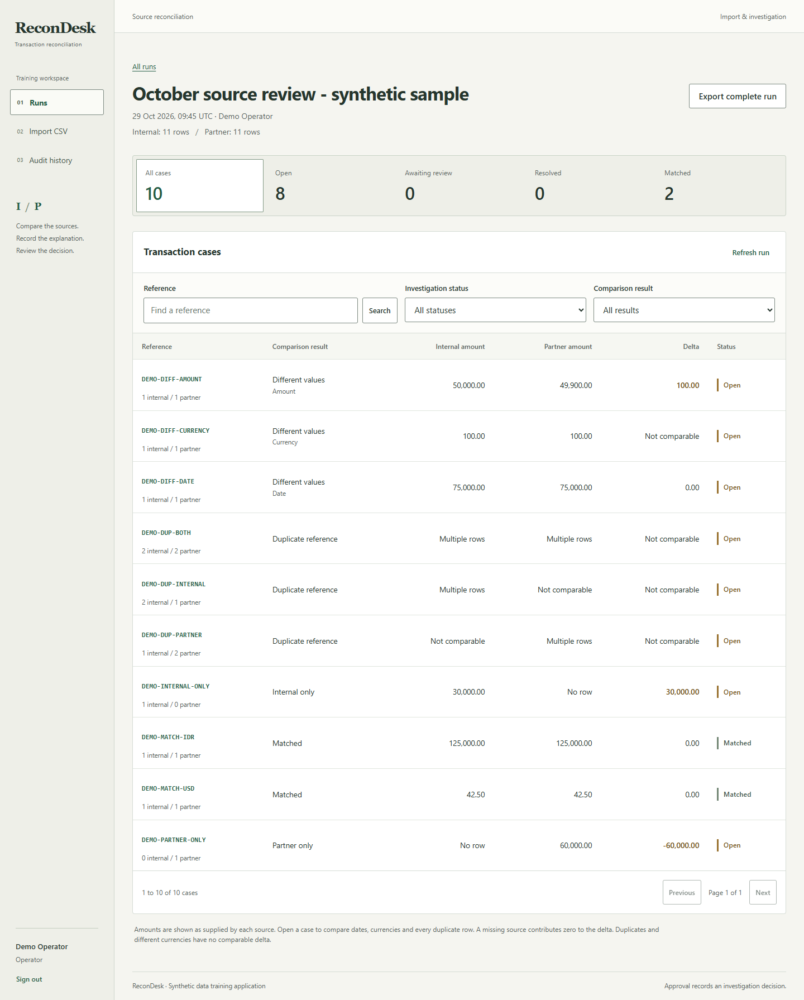

# ReconDesk

Compare two transaction CSV files, investigate differences, and ask a second person to review the explanation.

ReconDesk is a local portfolio and training application built with Java 17, Spring Boot 4.1.2, PostgreSQL 17, React, and TypeScript. Its sample transactions are synthetic. An approved case records an investigation decision; it does not change the imported transactions or move money.



## What you can do

- Import an internal file and a partner file in one transaction.
- Compare references and inspect amount, date, currency, missing-row, and duplicate exceptions.
- Keep every source row, including repeated references.
- Propose an explanation as an operator, then approve or reject it as a different reviewer.
- Search and filter cases, inspect the audit trail, and export the complete run to CSV.

The server enforces roles, version checks, CSRF protection, and import idempotency. The [architecture](docs/ARCHITECTURE.md) explains the boundaries and tradeoffs. This application has no external payment, email, or bank integration.

## Start locally on Windows

Install Docker Desktop with Compose and use PowerShell from this directory.

```powershell
.\scripts\Init.ps1
.\scripts\Start.ps1
```

Open [127.0.0.1:8096](http://127.0.0.1:8096). Read the generated password in `.local/LOCAL-CREDENTIALS.txt`, which Git ignores. The two local accounts are:

| Role | Email | Task |
| --- | --- | --- |
| Operator | `operator@recondesk.test` | Import files and propose explanations |
| Reviewer | `reviewer@recondesk.test` | Approve or reject proposals |

The login form does not prefill the password. Restarting the application keeps existing accounts and runs. See [operations](docs/OPERATIONS.md) for prerequisites, lifecycle commands, configuration, and troubleshooting.

## Try the workflow

1. Sign in as the operator and open **Import CSV**.
2. Give the run a name and select [internal.csv](samples/internal.csv) and [partner.csv](samples/partner.csv), or download them from the import screen.
3. Inspect the resulting 10 cases: 2 matched cases and 8 open exceptions. Each source contains 11 data rows.
4. Open `DEMO-DIFF-AMOUNT`, inspect both rows, and propose a specific explanation of at least 10 characters.
5. Sign out, then sign in as the reviewer. Approve or reject the pending proposal with a decision note.
6. Inspect the case history and Audit page, then export the run.

Approval changes `PENDING` to `RESOLVED`; rejection returns it to `OPEN`. Neither decision changes the comparison classification or the source rows. [Sample notes](samples/README.md) list every expected classification. Deliberately invalid files in [samples/invalid](samples/invalid) demonstrate whole-import validation.

## Screenshots

Repository captures are stored at the following paths. Each capture uses the synthetic sample data.

| View | Capture |
| --- | --- |
| Login | [Login screen](docs/screenshots/01-login.png) |
| Workspace | [Run results](docs/screenshots/02-workspace.png) |
| Investigation | [Case review](docs/screenshots/03-case-review.png) |
| Mobile | [390 px layout](docs/screenshots/04-mobile.png) |

## Run checks and stop

```powershell
.\scripts\Test.ps1
.\scripts\Stop.ps1
```

The [verification record](docs/VERIFICATION.md) contains the actual commands, observed results, and measurement limits from the delivered checkout.

## SQL case study

The [SQL plan measurement](docs/benchmarks/README.md) compares one query before and after a composite index on 250,000 synthetic rows in a separate temporary database. The query groups daily amounts and computes a running total with a window function. The saved results agree; the plans show how PostgreSQL's access path changed. This is one paired local measurement, separate from the application's bounded CSV import workflow. Read the [SQL](benchmarks/query-plan.sql) and the complete plans before interpreting the timings.

## Read the project

| Document | Purpose |
| --- | --- |
| [Architecture](docs/ARCHITECTURE.md) | Data flow, matching rules, transactions, and design choices |
| [Code guide, Bahasa Indonesia](docs/CODE-GUIDE.md) | A walkthrough from a fresh checkout to the source files and functions |
| [Interview notes, Bahasa Indonesia](docs/INTERVIEW.md) | Explain the problem, decisions, failure cases, and next steps |
| [API](docs/API.md) | Routes, payloads, roles, and error behavior |
| [Operations](docs/OPERATIONS.md) | Start, stop, test, configuration, and recovery |
| [SQL case study](docs/benchmarks/README.md) | Reproducible temporary dataset, query plans, timings, and result comparison |
| [Implementation contract](docs/CONTRACT.md) | Shared interface and validation rules |

Imports are bounded to 1 MiB and 1,000 data rows per file, with at most 200 runs in one workspace. Processing is synchronous and atomic. A larger production workflow would need separate decisions about durable jobs, access scope, retention, deployment, and monitoring.
