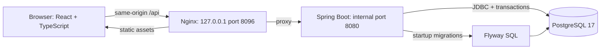
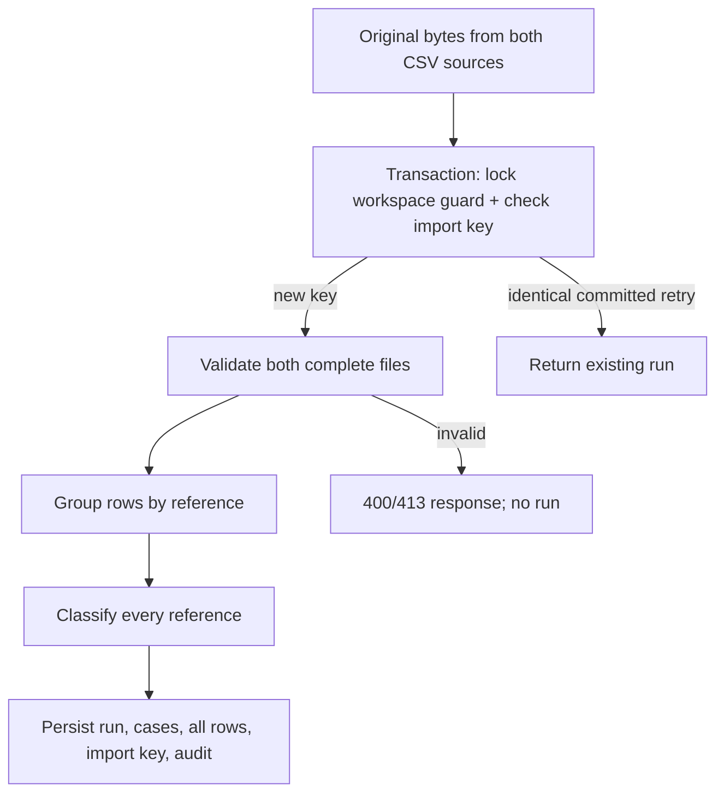
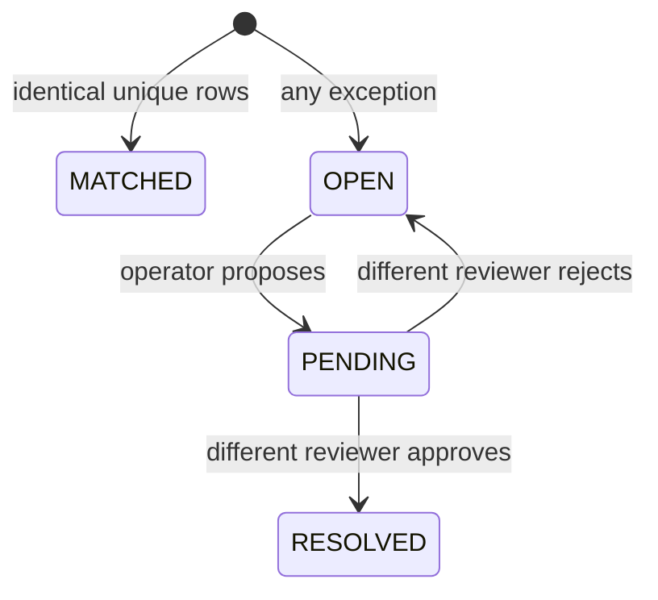

# Architecture

ReconDesk stores two validated transaction sources, compares them by reference, and tracks a separate investigation workflow. It is a local training application with synthetic users and data. A review decision is an annotation on a case; it does not settle a payment or rewrite a source record.

## Runtime boundary

Nginx serves the compiled frontend and proxies `/api` to the backend. The browser uses one origin, which makes the cookie and origin checks explicit. PostgreSQL persists users, sessions, source rows, comparisons, proposals, and audit events. Flyway applies the schema before the application handles requests. The application does not create tables on the first request.

The web container runs Nginx as the `nginx` user, with its PID and temporary paths under `/tmp`. The server applies an origin-restricted Content Security Policy. The backend's session filter protects every backend path, with only exact `GET /api/health` and `POST /api/auth/login` public exceptions. Its protection does not depend on the raw URI starting with `/api/`.

The backend uses Spring MVC and Spring JDBC. SQL stays visible so the transaction boundaries, row locks, filters, and ordering can be inspected directly. Amounts use `BigDecimal` in comparison code and fixed-scale `numeric` columns in PostgreSQL. API amounts are strings with two decimal places, avoiding JavaScript floating-point conversion.

## Import and comparison

The service locks the singleton workspace guard and checks for a committed idempotency key before parsing a new import. The importer reads UTF-8 CSV, validates the exact schema and each field, and retains validated source rows in memory within the bounded upload size. Both files must pass before the service writes a run. Uploaded files are not saved to disk. This simple guard also serializes imports, including bounded parsing work; it trades import parallelism for a directly inspectable capacity and retry guarantee.

Each file permits 1 to 1,000 data rows and at most 1 MiB. A reference is 1 to 64 characters using letters, digits, `.`, `_`, `/`, and `-`. Currency is `IDR` or `USD`; values must be nonnegative decimals with at most two fractional digits and at most `999999999999.99`. See [API validation](API.md#csv-validation) for the remaining rules.

The classification order is deliberate:

1. If either source has more than one row for the reference, classify `DUPLICATE` and retain all rows.
2. If exactly one source has a row, classify `INTERNAL_ONLY` or `PARTNER_ONLY`.
3. If both sources have one row, compare amount, date, and currency. All equal produces `MATCHED`; otherwise produce `DIFFERENT` and list the mismatched fields.

A matching amount does not join different references. Duplicate rows do not cancel out or disappear. Duplicate summaries use null amounts and delta because selecting one row would imply a comparison the application did not perform. A unique pair with different currencies also has null delta because there is no exchange-rate calculation. For one-sided cases, delta uses zero for the missing side while classification keeps the missing-source context.

Imports run synchronously inside a small, bounded workload. Spring Batch and a durable job queue are not part of this implementation. A future large-file design would need durable file storage, a job record, restart semantics, chunk validation, and a policy for when results become visible. Adding a background thread alone would not provide those guarantees.

The separate [SQL case study](benchmarks/README.md) uses a temporary 250,000-row synthetic table to examine an aggregation/window query before and after an index. It does not change the application schema or expand the import limit. Its one paired local measurement and complete result comparison are documented with the saved plans.

## Persistence model

| Table | Responsibility |
| --- | --- |
| `app_user` | Two seeded local users with password hashes and roles |
| `app_session` | Hashed session identifiers, CSRF token, and expiry |
| `login_throttle` | Login failure window and temporary blocking state |
| `workspace_guard` | Serializes workspace-wide capacity and import work |
| `recon_run` | Import name, actor, timestamp, and source row counts |
| `import_key` | Actor-scoped idempotency key, payload hash, and committed run |
| `recon_case` | One reference, classification, workflow state, version, and summary |
| `source_row` | Every validated row with original source and CSV record number |
| `proposal` | Operator explanation and reviewer decision history |
| `audit_event` | Actor, action, note, timestamp, and run/case association |

Source rows remain available after resolution. Counts for open, pending, and resolved cases reflect current workflow state. Classification remains the result of the original comparison.

## Investigation state and concurrency

Only operators import and propose. Only reviewers decide, and the server checks that the decision actor differs from the proposer. Both roles can read the workspace. There is no registration flow or tenant isolation in this local version.

Proposal and decision requests include the case's `expectedVersion`. The service locks the case with `SELECT ... FOR UPDATE`, checks its version and state, updates the case and proposal, and appends an audit event in the same transaction. Stale work receives `409`, allowing the frontend to refresh instead of overwriting another decision. Database constraints back up the service checks, including one pending proposal per case and distinct proposer/reviewer identifiers.

An import has a UUID `Idempotency-Key`, scoped to the actor. The payload fingerprint includes the run name and both original byte streams with boundaries between them. A committed retry with identical content returns the existing run. Reusing the key for different content returns `409`. The frontend retains an import identity for retry after an uncertain response; changing the files or name requires a new identity.

## Session and audit limits

Login creates an opaque session cookie with a 12-hour lifetime. The database stores its hash. Authenticated mutations require the configured exact origin and an `X-CSRF-Token`. Login also checks origin and requires JSON. Logout revokes the current session. The generated demo password is kept in ignored local files and does not reset existing users on restart.

The API offers no audit-editing or deletion route. That provides an application-level history, not tamper-proof storage against database administrators. This local deployment also has no external identity provider, MFA, cross-organization authorization, payment integration, or production backup service. The [operations guide](OPERATIONS.md) describes the local data lifecycle.
