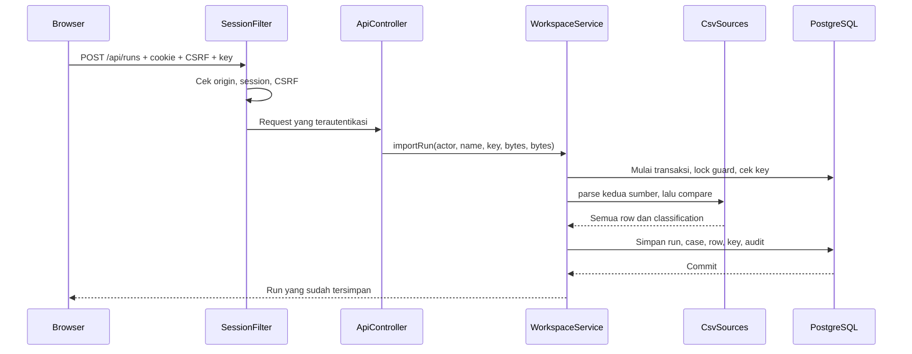

# Panduan kode dari nol sampai aplikasi berjalan

Panduan ini mengikuti nama file dan fungsi di repository. Mulai dengan menjalankan aplikasi dan melihat satu alur lengkap, kemudian baca kode sesuai urutan request. Data contoh, akun, reference, dan nominal merupakan data sintetis untuk latihan.

## 1. Siapkan dan jalankan

Buka PowerShell di direktori yang berisi `compose.yml`, `backend/`, `frontend/`, dan `scripts/`. Docker Desktop harus aktif dengan Linux containers.

```powershell
.\scripts\Init.ps1
.\scripts\Start.ps1
```

Buka `http://127.0.0.1:8096`. Jangan mengganti host menjadi `localhost` karena pemeriksaan origin menggunakan alamat yang persis sama. Password awal ada di `.local/LOCAL-CREDENTIALS.txt`. File itu dan `.env` bersifat privat dan diabaikan Git.

Login sebagai `operator@recondesk.test`, import `samples/internal.csv` dan `samples/partner.csv`, lalu buka satu pengecualian. Setelah mengajukan penjelasan, logout dan login sebagai `reviewer@recondesk.test` untuk mengambil keputusan. Persetujuan tidak mengubah baris sumber dan tidak memindahkan uang.

Untuk menghentikan aplikasi, jalankan `.\scripts\Stop.ps1`. Database tetap tersimpan. Untuk pemeriksaan otomatis, jalankan `.\scripts\Test.ps1`; hasil nyata dan keterbatasan pemeriksaan ada di [VERIFICATION.md](VERIFICATION.md).

## 2. Peta direktori

| Lokasi | Isi |
| --- | --- |
| `backend/` | API Java, SQL, parser, session, workflow, dan test backend |
| `frontend/` | React, TypeScript, CSS, pengujian frontend, dan konfigurasi Nginx |
| `scripts/` | Inisialisasi kredensial, start/stop, bootstrap Maven, dan verifikasi lokal |
| `samples/` | CSV sintetis yang valid dan contoh yang sengaja invalid |
| `benchmarks/` | SQL untuk case study query plan pada tabel sementara sintetis |
| `docs/` | Kontrak, arsitektur, API, operasi, tutorial, catatan wawancara, dan bukti verifikasi |
| `compose.yml` | Aplikasi lokal dengan database persisten |
| `compose.test.yml` | PostgreSQL terpisah untuk test integrasi |

## 3. Alur request yang perlu diikuti



Frontend mengatur input, status tunggu, dan pesan kesalahan. Backend tetap memvalidasi semua aturan karena request dapat datang tanpa UI. Database menyediakan transaksi, constraint, dan row lock. Tidak ada pemanggilan provider pembayaran.

## 4. Backend, per file

Semua class aplikasi berada di `backend/src/main/java/com/recondesk/`.

### `ReconDeskApplication.java`

`main()` memanggil `SpringApplication.run(...)`. Anotasi `@SpringBootApplication` mengaktifkan konfigurasi dan pencarian komponen. Baca file ini untuk menemukan titik masuk, lalu pindah ke filter dan controller; logika bisnis tidak berada di `main()`.

### `Model.java`

File ini menampung Java record kecil yang digunakan lintas lapisan:

- `User` membawa identitas dan role tanpa password hash.
- `SourceRow` membawa nomor record CSV, reference, date, amount, dan currency. `money()` mengubah string amount menjadi `BigDecimal` untuk perbandingan.
- `Comparison` membawa classification, field yang berbeda, semua row dari kedua sisi, serta nilai ringkasan.
- `Page<T>` membungkus items, total, page, dan pageSize.
- `Login`, `ProposalInput`, dan `DecisionInput` merupakan bentuk input JSON. Dua input workflow membawa `expectedVersion`.
- `AuthResponse` menyusun user dan CSRF token pada respons session. `toString()` pada `Login` dan `AuthResponse` menyamarkan password/token agar logging objek tidak menuliskannya.

Record ini bukan tabel database. `WorkspaceService` memetakan sebagian hasil SQL ke map respons, sedangkan record dipakai untuk struktur yang kecil dan tetap.

### `SessionFilter.java`

`doFilterInternal()` berjalan sebelum controller untuk seluruh path backend. Urutannya: tambahkan header respons, periksa origin untuk mutation, beri pengecualian hanya untuk exact `GET /api/health` dan `POST /api/auth/login`, baca cookie, autentikasi session, lalu periksa CSRF untuk mutation. Session yang sah dimasukkan ke request attribute `recon.session`. Gangguan database saat pengecekan session menghasilkan error JSON umum.

Backend ini melayani API; file frontend dilayani Nginx. Filter tidak melewati request hanya karena raw URI tidak diawali `/api/`. Ini menjaga pemeriksaan session ketika pemetaan route menangani variasi path seperti matrix parameter atau encoding secara berbeda. Pengecualian publik tetap menggunakan path dan method yang persis.

`error()` menulis error JSON untuk penolakan di lapisan filter. `COOKIE` berisi nama `recondesk_session`; `SESSION` adalah nama request attribute. Filter tidak menentukan apakah sebuah reference cocok. Tanggung jawabnya adalah batas request dan session.

### `AuthService.java`

| Fungsi | Tanggung jawab |
| --- | --- |
| `seedAccounts()` | Membuat dua akun sintetis hanya saat tabel akun kosong, dalam transaksi dan di bawah guard |
| `login()` | Validasi input, normalisasi email, cek throttle, verifikasi BCrypt, buat session 12 jam, dan hapus state throttle setelah login sah |
| `authenticate()` | Validasi bentuk token, hash token, cari session yang belum kedaluwarsa, dan kembalikan user serta CSRF token |
| `logout()` | Menghapus session saat ini berdasarkan hash |
| `user()` | Memetakan kolom SQL menjadi record `User` |
| `token()` | Membuat token acak dari `SecureRandom` |
| `sha256()` | Menghasilkan hash hex untuk token dan identitas throttle |
| `payloadHash()` | Meng-hash nama run dan dua byte stream dengan awalan panjang setiap bagian |

`Session` membawa user, CSRF token, dan hash session. `LoginResult` memisahkan session dari token mentah yang perlu dimasukkan ke cookie. Kedua record menyamarkan token pada `toString()`. BCrypt tidak dipakai sebagai hash idempotency; tujuan password hash dan fingerprint payload berbeda.

`payloadHash()` tidak sekadar menempelkan dua file. Awalan panjang membuat pasangan byte yang berbeda tidak menjadi ambigu hanya karena batas antarfile berpindah. Nama run dan byte asli termasuk dalam identitas payload.

### `ApiController.java`

Controller menghubungkan HTTP dengan service. `health()` menjalankan `SELECT 1`. `login()`, `session()`, dan `logout()` mengelola respons autentikasi dan cookie. Helper `cookie()` menetapkan HttpOnly, SameSite, path, umur, dan konfigurasi Secure; `current()` mengambil session dari filter.

`runs()`, `run()`, `cases()`, `detail()`, dan `audit()` meneruskan request baca. `create()` mengambil multipart dan UUID idempotency key, memeriksa role, kemudian mengembalikan status `201` untuk import baru atau `200` untuk replay. `propose()` dan `decide()` meneruskan input workflow beserta aktor. `export()` menambahkan content type dan nama download CSV.

Controller tidak percaya pada role yang dikirim klien. Aktor berasal dari session yang sudah diperiksa filter. Service mengulang pemeriksaan role pada mutation sehingga aturan tetap berlaku bila method dipanggil dari jalur lain.

### `CsvSources.java`

`parse(bytes, source)` merupakan batas validasi file. Method menolak ukuran berlebih, memakai decoder UTF-8 yang melaporkan encoding invalid, menghapus BOM awal jika ada, dan meminta Apache Commons CSV membaca struktur RFC-style. Header harus persis `reference,date,amount,currency`. Record dibaca melalui iterator, sehingga batas 1.000 row dapat ditolak tanpa mengumpulkan seluruh objek CSVRecord terlebih dahulu. Byte upload dan list row tervalidasi tetap dibatasi di memori; ini bukan parser file besar dengan penyimpanan durable.

Setiap record harus memiliki empat kolom. Reference dibersihkan pada bagian luar lalu diperiksa dengan regex; date harus berformat ISO dan merupakan tanggal kalender yang sah dengan tahun 0001 sampai 9999; amount harus desimal nonnegatif dengan paling banyak dua angka pecahan; currency hanya `IDR` atau `USD`. Parser menyimpan nomor record CSV dan mengembalikan list yang tidak dapat diubah. `validateQuotes()` memeriksa posisi tanda kutip, escape kutip, dan penutupan field sebelum parsing library. `rowError()` membuat pesan sumber dan nomor record; `values()` membantu memeriksa header.

`compare(internal, partner)` mengelompokkan kedua list berdasarkan reference. `TreeMap` menghasilkan urutan reference deterministik. Periksa duplicate lebih dahulu, kemudian satu sisi yang hilang, kemudian perbedaan amount/date/currency pada pasangan unik. Method menyimpan semua row dan tidak menghapus duplicate.

Delta dihitung sebagai internal dikurangi partner. Sisi yang hilang memakai nol sebagai dasar aritmetika; pembaca tetap harus melihat classification. Duplicate menggunakan null untuk kedua nilai ringkasan dan delta. Pasangan unik dengan currency berbeda juga menghasilkan delta null karena sistem tidak melakukan konversi mata uang.

`spreadsheetSafe()` mengawali nilai berisiko formula dengan apostrof sebelum export. CSV quoting menangani struktur sel; prefix ini menangani interpretasi spreadsheet. Kedua hal tersebut memiliki tujuan berbeda.

### `WorkspaceService.java`

Ini pusat query dan transaksi aplikasi.

`importRun()` memeriksa role, nama, key, dan batas byte, lalu menghitung fingerprint payload. Di dalam `TransactionTemplate`, method mengunci `workspace_guard`, memeriksa `import_key`, dan mengembalikan run lama bila retry identik sudah commit. Untuk key baru, kedua sumber diparse dan dibandingkan sebelum insert. Method memeriksa batas 200 run, menyimpan run, case, seluruh source row, key, dan audit dalam transaksi yang sama. `addRows()` menyiapkan batch source rows; `money()` mengubah nilai string menjadi parameter SQL desimal. Tanggal dipasang dan dibaca melalui JDBC 4.2 `LocalDate` agar konversi kalender legacy `java.sql.Date` tidak mengubah tanggal historis yang valid.

Guard tunggal membuat import sederhana untuk diperiksa tetapi menserialisasi semua import, termasuk parsing yang dibatasi ukurannya. Ini keputusan untuk workload lokal kecil, bukan klaim bahwa semua import berjalan paralel.

| Kelompok fungsi | Detail |
| --- | --- |
| `runs()` dan `run()` | Membaca run dengan jumlah kasus per state; `runMap()` memetakan hasil |
| `cases()` | Memvalidasi filter dan search, menghitung total, menjalankan pagination dengan parameter terikat |
| `caseMap()` | Memetakan classification, differences, state, version, dan amount string/null |
| `detail()` | Mengambil case, nama run, semua source row, proposal, dan audit terkait |
| `propose()` | Mengunci case OPEN, memeriksa versi, insert proposal, mengubah state ke PENDING, increment version, dan append audit |
| `decide()` | Memeriksa role, versi, state proposal, dan aktor berbeda; approve ke RESOLVED atau reject ke OPEN; simpan keputusan dan audit bersama |
| `lockedCase()` | Mengambil case dengan `SELECT ... FOR UPDATE` |
| `checkVersion()` | Menolak `expectedVersion` yang tidak sama dengan versi saat ini |
| `validateMutation()` | Memeriksa versi nonnegatif serta panjang note setelah trim |
| `characters()` | Menghitung Unicode code point agar batas nama/note konsisten dengan panjang karakter PostgreSQL |
| `requireRole()` | Menolak aktor yang tidak memiliki role yang dibutuhkan |
| `audit(int)` dan `auditMap()` | Membaca halaman riwayat terbaru dengan urutan stabil |
| `audit(...)` | Menambahkan event pada transaksi bisnis yang sedang berjalan |
| `export()` | Menulis seluruh hasil run tanpa pagination, memakai CSVPrinter dan pelindung formula |
| `offset()` | Memvalidasi page lalu menghitung offset dengan page size 25 |
| `now()`, `timestamp()`, `decimal()`, `map()` | Membantu pemetaan waktu UTC, desimal dua digit, dan respons dengan field null |

Query search memakai parameter SQL, serta meng-escape wildcard pencarian literal. SQL yang dirangkai memilih klausa dari filter yang telah diperiksa; nilai pengguna tidak ditempelkan sebagai SQL mentah.

`propose()` dan `decide()` mengembalikan detail baru setelah perubahan. Request keputusan yang kalah dalam perebutan versi akan mendapat konflik, bukan menimpa keputusan pertama. Constraint database tetap berfungsi sebagai lapisan penjaga tambahan.

### `ApiException.java` dan `ApiErrors.java`

`ApiException` membawa status, code, dan message. Factory `invalid()`, `conflict()`, `missing()`, dan `forbidden()` menyatukan bentuk error bisnis.

`ApiErrors` adalah `@RestControllerAdvice`. `application()` menangani error bisnis, `upload()` menangani batas multipart, `validation()` menangani format request, `missing()` menangani route yang tidak tersedia, dan `failure()` memberikan pesan umum untuk error tak terduga. `response()` membuat JSON konsisten. Detail stack trace tidak dikirim ke browser.

### File konfigurasi dan SQL backend

| File | Yang dibaca |
| --- | --- |
| `backend/pom.xml` | Java 17, Spring Boot 4.1.2, dependency JDBC/Flyway/PostgreSQL/CSV/crypto, dan plugin packaging |
| `backend/src/main/resources/application.properties` | Port, JDBC, pool, batas multipart, threshold in-memory 2MB, JSON coercion, origin, cookie, password seed, dan kategori logging |
| `backend/src/main/resources/db/migration/V1__workspace.sql` | Seluruh tabel awal, foreign key, index, CHECK constraint, guard, serta unique pending proposal |
| `backend/Dockerfile` | Build dan runtime backend di container |

Urutan migrasi Flyway berdasarkan nama `V1__...`. Jangan mengedit migrasi yang sudah dipakai untuk mengganti skema yang telah berjalan; perubahan lanjutan semestinya memakai migrasi versi berikutnya.

## 5. Frontend, per file

### `frontend/src/main.tsx` dan `App.tsx`

`main.tsx` memasang React ke elemen `root`, memuat CSS, dan merender `App` dalam `StrictMode`.

`useHashRoute()` membaca route hash dan query, mendengarkan perubahan URL, lalu mengembalikan path, segments, dan `URLSearchParams`. `App()` menyimpan session, status pengecekan, draft import, notifikasi, dan status logout. `checkSession()` mengambil session yang masih berlaku; `logout()` baru membersihkan session lokal setelah server mengonfirmasi pencabutan. Event `recondesk:session-expired` mengembalikan tampilan ke login.

Komponen `Login()` dan `submit()` di dalamnya mengirim email/password. Tombol akun demo hanya mengisi email dan memindahkan fokus ke password. Password tidak ditulis ke source atau diisi otomatis. Sesudah login, `App` merender Runs, Import, Audit, atau detail case berdasarkan hash route.

### `frontend/src/api.ts`

`ApiError` membawa status HTTP, code, dan details. `setCsrfToken()` menyimpan token session di memori modul. `api<T>()` menambahkan credential same-origin dan header CSRF, membedakan FormData dari JSON, menerjemahkan respons error, serta mengirim event ketika session kedaluwarsa. Request yang dibatalkan tidak diubah menjadi kesalahan jaringan biasa.

`errorMessage()` menyiapkan pesan untuk UI. `resultUncertain()` membedakan kegagalan dengan respons pasti dari kegagalan jaringan atau server yang belum memastikan hasil. `downloadExport()` mengambil blob CSV dengan session, membuat link download sementara, lalu melepaskan object URL.

### `frontend/src/types.ts` dan `utils.ts`

`types.ts` mendefinisikan bentuk session, user, page, run, summary, row, proposal, audit, dan detail sesuai kontrak HTTP. TypeScript membantu saat build, tetapi tidak menggantikan validasi request di server.

`money()` memformat string tanpa melakukan hitung uang melalui `Number`. `dateTime()` menampilkan waktu UTC. `actionLabel()` mengubah label event menjadi teks terbaca. `classificationLabels` dan `stateLabels` memisahkan enum API dari label tampilan.

`noteLength()` menghitung Unicode code point setelah trim, sedangkan `validateNote()` memeriksa batas 10 sampai 2.000 karakter. Counter note memakai perhitungan yang sama. `readOnlyReason()` menjelaskan mengapa user tidak dapat mengubah kasus pada state tertentu. `validateImport()` menghitung karakter nama dengan code point, lalu memeriksa keberadaan file, file kosong, dan ukuran sebelum request. Pemeriksaan CSV lengkap tetap dilakukan backend.

### `frontend/src/components.tsx`

`useResource<T>()` menjalankan request baca sesuai path dan revision. Hook menyimpan data/loading/error, membatalkan request lama saat path berubah atau komponen dilepas, dan menyediakan `refresh()` serta `setData()`.

`Loading`, `ErrorBox`, dan `Empty` membuat state layar jelas. `StateLabel` menampilkan state dari label yang konsisten. `Pagination` memakai total serta pageSize dari server untuk tombol Previous/Next. `PageHeading` menyusun judul, penjelasan, dan aksi halaman. Label status bukan pengganti aturan state di server.

### `frontend/src/ImportPage.tsx`

`ImportDraft` menyimpan nama, dua objek File, key, actorId, status, dan error. `newImportDraft()` mengembalikan draft kosong. Draft disimpan oleh `App`, sehingga berpindah view dalam tab tidak langsung menghilangkan identitas retry.

`ImportPage()` membedakan akses operator/reviewer dan mengunci perubahan input saat request pending atau hasilnya uncertain. `update()` mengosongkan identitas lama saat input boleh berubah. `submit()` memvalidasi awal, memakai key lama atau UUID baru, menyusun FormData, lalu menunggu respons server. Guard ref menolak request kedua secara sinkron saat request pertama masih berlangsung. Timeout 60 detik membatalkan penantian klien; pembatalan itu tidak membuktikan bahwa transaksi server batal. Keberhasilan mengosongkan draft; kegagalan uncertain mempertahankan file dan key agar retry tidak membuat run baru. `FileField()` menampilkan satu input sumber dengan label dan ukuran.

Draft berada di memori tab. Refresh penuh atau menutup tab dapat menghilangkannya; ini bukan antrean upload durable. Jangan mendeskripsikan penyimpanan draft sebagai pemulihan lintas perangkat atau restart browser.

### `frontend/src/WorkspacePages.tsx`

`RunsPage()` membaca halaman run dan menampilkan keadaan kosong, error, atau daftar hasil. `RunPage()` membaca ringkasan run dan daftar case berdasarkan filter URL. `filter()` memperbarui query serta mengatur page kembali untuk filter baru; `exportCsv()` menjalankan download dengan status sibuk dan error nyata.

`sourceAmount()` membedakan tidak ada row, multiple rows, dan satu amount. `Count` adalah tombol filter state, bukan angka metrik fiktif. `AuditPage()` membaca halaman audit, sedangkan `AuditTable()` dipakai kembali pada halaman audit dan detail case. `pageFromQuery()` mengubah query page yang sah menjadi angka nonnegatif.

### `frontend/src/CasePage.tsx`

`CasePage()` mengambil detail case dan menyimpan tab aktif, note, keputusan, status sibuk, error, serta kebutuhan refresh. `refresh()` meminta state terkini. `changeTab()` mendukung tombol panah, Home, dan End untuk navigasi tab dengan keyboard.

`submit()` memeriksa note dan alasan read-only, mencari proposal pending untuk reviewer, lalu mengirim `expectedVersion` dari detail yang dibaca. Respons sukses mengganti detail dengan data server. Konflik atau hasil uncertain meminta refresh sebelum mutation lain dan mempertahankan note.

`comparisonExplanation()` menjelaskan classification. `SourceBlock()` merender semua row tanpa memilih salah satu duplicate, termasuk nomor record. `ProposalRecord()` menampilkan penjelasan dan keputusan beserta aktornya. Teks pengguna dirender sebagai teks React, bukan HTML mentah.

### File konfigurasi dan tampilan frontend

| File | Tanggung jawab |
| --- | --- |
| `frontend/src/styles.css` | Warna, tipografi, ledger/source comparison, focus, layout, dan reflow layar sempit |
| `frontend/index.html` | Dokumen awal dan elemen tempat React dipasang |
| `frontend/package.json` | Dependency serta perintah dev/build/test/e2e |
| `frontend/package-lock.json` | Versi dependency npm yang dapat dipasang ulang dengan `npm ci` |
| `frontend/tsconfig.json` | Pemeriksaan dan build TypeScript |
| `frontend/vite.config.ts` | Plugin React, proxy API dev, serta pola unit test |
| `frontend/playwright.config.ts` | Browser Edge, alamat aplikasi, satu worker, serta laporan/trace kegagalan browser |
| `frontend/Dockerfile` | Build frontend dan image server statis |
| `frontend/nginx-main.conf` | Proses Nginx, PID di `/tmp`, path temporary, MIME, dan include server config untuk runtime tanpa root |
| `frontend/nginx.conf` | Static asset, route aplikasi, proxy `/api`, healthz, dan header HTTP |
| `frontend/public/samples/internal.csv` dan `partner.csv` | Salinan CSV sintetis yang dapat diunduh dari browser |

## 6. Script dan container

| File | Tanggung jawab dan fungsi |
| --- | --- |
| `scripts/Common.ps1` | Menetapkan root project; `Get-ReconEnvironment` membaca konfigurasi sebagai data; `Invoke-ReconDocker` menjalankan Docker dan memeriksa exit code |
| `scripts/Init.ps1` | `New-ReconSecret` membuat secret acak; script membuat `.env` dan petunjuk kredensial lokal bila belum ada |
| `scripts/Start.ps1` | Menjalankan Init, memastikan origin, build API lalu web secara berurutan, lalu Compose `up --no-build` dengan health wait; `-NoBuild` melewati build |
| `scripts/Stop.ps1` | `docker compose down` tanpa menghapus volume database |
| `scripts/Maven.ps1` | Mengunduh Maven 3.9.16 dengan pemeriksaan SHA-512, memakai cache `.local/m2`, lalu menjalankan argumen Maven di backend |
| `scripts/Test.ps1` | Menjalankan pemeriksaan dengan database test terpisah dan membersihkan resource test |
| `scripts/Benchmark.ps1` | Menjalankan database benchmark sementara, membaca bagian output melalui `Get-ReconSegment()`, memeriksa hasil query yang sama, dan menyimpan plan/result/summary |
| `compose.yml` | PostgreSQL persisten, API internal, web di 8096, dependency health, dan batas resource lokal |
| `compose.test.yml` | Database test di 5447 dengan penyimpanan sementara, terpisah dari aplikasi di 5446 |
| `.gitignore` | Mengecualikan secret, cache, dependency, dan hasil build lokal |
| `.gitattributes` | Aturan file teks repository |
| `.dockerignore` | Mengecualikan secret, cache, dependency, build output, dan screenshot dari build context |
| `.env.example` | Template nama konfigurasi lokal; gunakan Init untuk menghasilkan kredensial |
| `.github/workflows/verify.yml` | Job backend dengan PostgreSQL test, unit/build/audit frontend, lalu workflow browser pada stack CI terisolasi |

`frontend/Dockerfile` memakai `USER nginx` dan konfigurasi utama tersendiri. Proses mendengarkan port 8080 tanpa hak root; PID serta temporary path berada di `/tmp`. Compose memasang path sementara berbasis memori dan root filesystem read-only. `nginx.conf` menetapkan CSP dengan script/style/connect berasal dari origin aplikasi. Perubahan asset eksternal harus mempertimbangkan kebijakan ini.

## 7. Membaca test tanpa mengarang hasil

`backend/src/test/java/com/recondesk/CsvSourcesTest.java` menguji parser dan comparison tanpa database: BOM/quoting, desimal persis, input invalid, encoding, batas, duplicate, formula export, serta batas bagian fingerprint payload.

`backend/src/test/java/com/recondesk/PostgresIntegrationTest.java` memakai PostgreSQL nyata untuk session, origin, CSRF, expiry/logout, import atomik, retry paralel, role, versi, reviewer berbeda, rejection history, keputusan yang berlomba, export, serta throttle. Class ini aktif bila `RECON_TEST_DATABASE_URL` terisi. Menjalankan unit test saja tidak membuktikan skenario database tersebut sudah dijalankan.

`frontend/src/utils.test.ts` memakai Vitest dalam lingkungan Node. Test mencakup penyajian desimal besar tanpa floating point, alasan read-only berdasarkan role/state/aktor, resubmission setelah rejection, batas input import/note termasuk karakter astral Unicode, serta pengelompokan error yang hasilnya uncertain. Helper `detail()` membuat fixture case kecil untuk assertion itu.

`frontend/src/api.test.ts` menguji pembentukan header CSRF/content type, FormData tanpa merusak multipart boundary, idempotency key, error 401 dan event expiry, serta respons jaringan yang hilang. Test ini memakai transport yang dikendalikan, bukan bukti bahwa browser telah terhubung ke database nyata.

`frontend/tests/workflow.spec.ts` memakai Playwright dan aplikasi nyata. Helper `login()` masuk sesuai role; `importPair()` mengisi form dengan file sintetis. Skenario utama sengaja menghilangkan respons import setelah server commit, lalu memeriksa retry dengan key sama dan alur rejection, resubmission, approval, history, filter, export, dan audit. Tab operator kedua yang memegang versi lama harus mendapat konflik sebelum refresh. Skenario layar 390 px memeriksa alasan akses reviewer, download sample, signout, fokus keyboard pada login, serta overflow halaman. Script memerlukan `RECON_DEMO_PASSWORD`; tanpa itu test ditandai skip, bukan lulus. `frontend/playwright.config.ts` memilih Edge secara lokal atau Chromium di CI, menerima override `RECON_BROWSER_CHANNEL`, dan membaca alamat dari `RECON_BASE_URL` dengan default origin lokal.

Baca assertion dan setup masing-masing test. Nama test menjelaskan tujuan; laporan eksekusi membuktikan apakah test itu dijalankan dan lulus. Gunakan [VERIFICATION.md](VERIFICATION.md) untuk hasil checkout ini, termasuk pemeriksaan frontend dan browser yang tersedia pada versi akhir.

## 8. Membaca case study SQL

Jalankan `.\scripts\Benchmark.ps1` saat port 5447 bebas dan test database lain sudah berhenti. Script memakai project Compose `recondesk-benchmark`, terpisah dari database aplikasi. Tidak ada data pengguna yang diperlukan.

`benchmarks/query-plan.sql` membuka transaksi, membuat `TEMP TABLE bench_transactions`, dan mengisi 250.000 baris melalui `generate_series`. Field account, tanggal, nominal, dan reference dihasilkan secara deterministik. Query memilih account 42 pada interval 1 Januari sampai sebelum 1 April 2026, mengelompokkan amount per hari, lalu menghitung running total dengan `sum(total) OVER (ORDER BY transaction_date)`.

Urutan eksperimen adalah ANALYZE, baca hasil lengkap, simpan EXPLAIN ANALYZE BUFFERS JSON sebelum index, buat `(account_id, transaction_date) INCLUDE (amount)`, ANALYZE lagi, baca hasil lengkap, lalu simpan plan sesudah index. Script membandingkan kedua hasil dan berhenti bila berbeda. SQL mengakhiri transaksi dengan ROLLBACK; tabel dan index sementara tidak menjadi bagian skema aplikasi.

| File | Cara membaca |
| --- | --- |
| `docs/benchmarks/README.md` | Waktu pengukuran, versi PostgreSQL, jumlah input, timing, dan batas kesimpulan |
| `docs/benchmarks/before.json` | Plan awal, sequential scan, jumlah row yang tersaring, serta buffer read |
| `docs/benchmarks/after.json` | Plan sesudah index, bitmap index/heap scan, serta buffer hit |
| `docs/benchmarks/result.json` | Seluruh hasil report yang disepakati sebelum dan sesudah index |

Pasangan yang tersimpan pada PostgreSQL 17.11 mencatat execution time 94,499 ms sebelum index dan 5,696 ms sesudah index; hasil query sama. Ini satu pasangan pengukuran lokal dengan pembacaan hasil sebelum masing-masing EXPLAIN. Buffer read/hit berbeda pada kedua plan, sehingga cache dan pekerjaan lain pada mesin ikut memengaruhi timing. Jangan mengubah angka itu menjadi klaim throughput import atau janji peningkatan umum. Menjalankan script lagi mengganti seluruh bukti dengan hasil mesin dan waktu baru.

[Baca summary dan plan lengkap](benchmarks/README.md) sebelum menjelaskan efek index. Ukuran 250.000 row adalah dataset sementara untuk SQL, bukan batas import ReconDesk yang tetap 1.000 data row per sumber.

## 9. Latihan perubahan kecil

Untuk menambah currency, telusuri kontrak, parser, constraint SQL, label bantuan import, dan test. Jangan hanya mengganti dropdown frontend. Untuk menambah state investigasi, telusuri state machine, constraint, mutation, query count, enum TypeScript, filter, alasan read-only, dan audit.

Untuk mengubah algoritme matching, mulai dari contoh domain dan test `CsvSourcesTest`, lalu ubah `compare()`. Pertahankan source evidence agar investigator dapat memahami hasil. Untuk memperbesar kapasitas import, ukur workload dan rancang job durable; menaikkan angka batas saja tidak menyediakan retry, restart, atau pengendalian memori.
